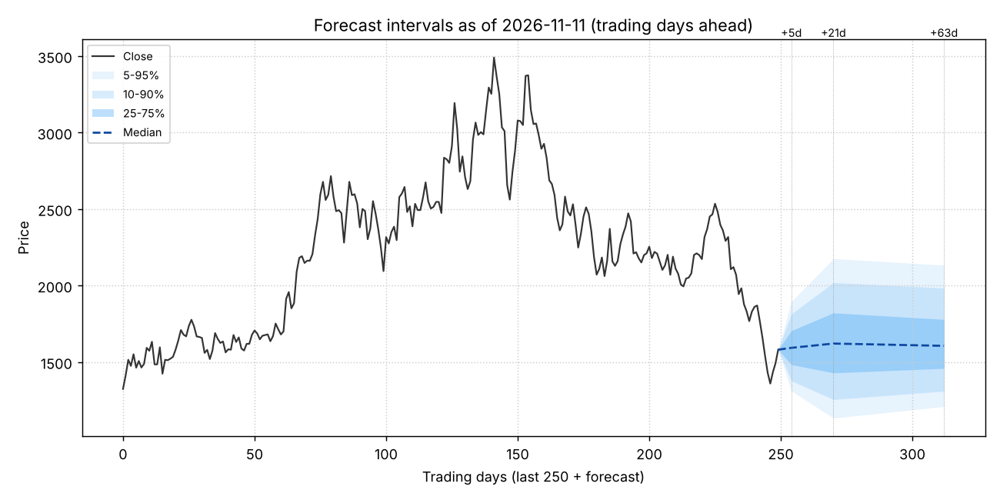

# 住友電気工業 (5802) — 日足による確率予測（基準日 2026-11-11）

> **【暫定（異種ソース混在データ）】** この結果は Stooq／Yahoo／Perplexity 経由の未検証 CSV を含む系列で作った。J-Quants（正本）で再計算するまで暫定であり、予測台帳には記録しない。改訂仕様 v0.2（`docs/revision_spec_v0.2.md`）参照。

> 日足（始値・高値・安値・終値・出来高）だけから作った確率予測と、その作り方を同じ銘柄の過去で採点した結果である。手順は事前に固定してある（`09_forecasting/02_protocol.md`）。教育目的であり、投資助言ではない。

## 1. 結論

基準日 2026-11-11 の終値は 1,582 円。

| 期間 | 中央値 | 50% 区間（25〜75%） | 80% 区間（10〜90%） | 上昇確率 | 採用モデル |
|---|---:|---|---|---:|---|
| 1週間（5営業日） | 1,593 | 1,484〜1,706 | 1,378〜1,815 | 53% | V3（EWMA と HAR の結合で伸縮） |
| 1か月（21営業日） | 1,622 | 1,430〜1,822 | 1,256〜2,019 | 56% | V2（HAR 型（レンジ・下落・出来高）で伸縮） |
| 3か月（63営業日） | 1,607 | 1,459〜1,779 | 1,310〜1,984 | 55% | B0（過去リターンの経験分布（伸縮なし）） |

- **方向の手がかり**: 採用基準（多重検定の補正後も、検証期間の前半・後半の両方で改善）を満たす方向の予測材料は、この銘柄の履歴からは見つからなかった。上昇確率は、過去の平均的な傾きだけを反映している。**この表が示すのは主に「値幅」である。**
- 1週間（5営業日）の値幅: 直近のボラティリティに合わせて伸縮する方式（V3）は、伸縮しない基準（B0）に比べて CRPS を 1.9% 改善した（検証 1546 時点。80% 区間の的中率は 79%）。
- 1か月（21営業日）の値幅: 直近のボラティリティに合わせて伸縮する方式（V2）は、伸縮しない基準（B0）に比べて CRPS を 0.4% 改善した（検証 1530 時点。80% 区間の的中率は 78%）。
- 3か月（63営業日）の値幅: この銘柄の履歴では、直近のボラティリティに合わせて幅を伸縮しても予測は良くならなかった。過去のリターンの分布をそのまま使う（検証 1488 時点。80% 区間の的中率は 80%）。
- 直近の値動き: 5日 +2.5%、21日 -33.0%。RSI(14) は 37、25日線からの乖離率は -17.5%、52週高値（終値）からは -54.7%。
- 予測ボラティリティ（1か月先まで、年率換算）は 74%。この銘柄の過去の予測値の中で下から 98% の位置（100% に近いほど荒い局面）。

## 2. データの検査

- 注意: 出来高が 0 または欠損の日 42 日
- 注意: 10 日を超える空白が 1 か所: 2019-05-07（11日）
- 注意: 終値が 6 日続けて同じ箇所がある（売買停止か欠損の埋め合わせの可能性）
- 情報: 行数 6680、期間 2000-01-04〜2026-11-11
- 情報: 最終日は 2026-11-11（基準日 2026-11-12 の 1 日前）

## 3. 予測分布

### 1週間（5営業日）

予測の標準偏差は 11.4%（S3）。参考: S1（EWMA）10.4%、S2（HAR 型）12.4%、S3（結合）11.4%。過去平均による傾きは +0.13%。標本は過去 5,241 時点。

| 確率 | 5% | 10% | 25% | 50% | 75% | 90% | 95% |
|---|---:|---:|---:|---:|---:|---:|---:|
| 終値 | 1,312 | 1,378 | 1,484 | 1,593 | 1,706 | 1,815 | 1,896 |
| 変化率 | -17.1% | -12.8% | -6.2% | +0.8% | +7.8% | +14.7% | +19.9% |

| 終値の変化 | +3% 以上 | +5% 以上 | +10% 以上 | −3% 以下 | −5% 以下 | −10% 以下 |
|---|---:|---:|---:|---:|---:|---:|
| 確率 | 41% | 34% | 19% | 36% | 29% | 15% |

期間中の高値は中央値 1,692 円（25〜75%: 1,625〜1,782）、安値は中央値 1,485 円（25〜75%: 1,402〜1,544）。

| 水準 | 価格 | 現値比 | 期間中に届く確率 | 期間末の終値が上にある確率 |
|---|---:|---:|---:|---:|
| 75日移動平均／スイング安値（2026-08-25） | 2,118 | +33.9% | 2% | 1% |
| スイング安値（2026-09-15） | 1,961 | +24.0% | 5% | 3% |
| 25日移動平均／一目の基準線 | 1,917 | +21.2% | 8% | 4% |
| 切りのよい価格（上） | 1,600 | +1.2% | 84% | 48% |
| 切りのよい価格（下） | 1,500 | -5.2% | 56% | 71% |
| ボリンジャー−2σ | 1,283 | -18.9% | 7% | 96% |
| 20日安値 | 1,251 | -20.9% | 5% | 97% |
| 52週安値 | 1,187 | -24.9% | 3% | 98% |

### 1か月（21営業日）

予測の標準偏差は 21.4%（S2）。参考: S1（EWMA）21.2%、S2（HAR 型）21.4%、S3（結合）21.3%。過去平均による傾きは +0.53%。標本は過去 5,209 時点。

| 確率 | 5% | 10% | 25% | 50% | 75% | 90% | 95% |
|---|---:|---:|---:|---:|---:|---:|---:|
| 終値 | 1,134 | 1,256 | 1,430 | 1,622 | 1,822 | 2,019 | 2,176 |
| 変化率 | -28.3% | -20.6% | -9.6% | +2.5% | +15.2% | +27.7% | +37.6% |

| 終値の変化 | +5% 以上 | +10% 以上 | +15% 以上 | −5% 以下 | −10% 以下 | −15% 以下 |
|---|---:|---:|---:|---:|---:|---:|
| 確率 | 45% | 34% | 25% | 33% | 24% | 17% |

期間中の高値は中央値 1,813 円（25〜75%: 1,687〜1,981）、安値は中央値 1,404 円（25〜75%: 1,272〜1,503）。

| 水準 | 価格 | 現値比 | 期間中に届く確率 | 期間末の終値が上にある確率 |
|---|---:|---:|---:|---:|
| 75日移動平均／スイング安値（2026-08-25） | 2,118 | +33.9% | 13% | 6% |
| スイング安値（2026-09-15） | 1,961 | +24.0% | 27% | 13% |
| 25日移動平均／一目の基準線 | 1,917 | +21.2% | 33% | 16% |
| 切りのよい価格（上） | 1,600 | +1.2% | 93% | 53% |
| 切りのよい価格（下） | 1,500 | -5.2% | 74% | 67% |
| ボリンジャー−2σ | 1,283 | -18.9% | 26% | 88% |
| 20日安値 | 1,251 | -20.9% | 22% | 90% |
| 52週安値 | 1,187 | -24.9% | 16% | 93% |

### 3か月（63営業日）

採用モデルは B0（伸縮なし）で、過去 5,125 時点の 63 営業日リターンの分布をそのまま使う。参考: 直近のボラティリティから見た標準偏差の予測は、S1（EWMA）36.8%、S2（HAR 型）30.1%、S3（結合）33.3%。

| 確率 | 5% | 10% | 25% | 50% | 75% | 90% | 95% |
|---|---:|---:|---:|---:|---:|---:|---:|
| 終値 | 1,210 | 1,310 | 1,459 | 1,607 | 1,779 | 1,984 | 2,134 |
| 変化率 | -23.5% | -17.2% | -7.7% | +1.6% | +12.5% | +25.5% | +34.9% |

| 終値の変化 | +10% 以上 | +15% 以上 | +20% 以上 | +30% 以上 | −10% 以下 | −15% 以下 | −20% 以下 | −30% 以下 |
|---|---:|---:|---:|---:|---:|---:|---:|---:|
| 確率 | 30% | 21% | 16% | 7% | 21% | 13% | 7% | 3% |

期間中の高値は中央値 1,752 円（25〜75%: 1,664〜1,888）、安値は中央値 1,444 円（25〜75%: 1,323〜1,521）。

| 水準 | 価格 | 現値比 | 期間中に届く確率 | 期間末の終値が上にある確率 |
|---|---:|---:|---:|---:|
| 75日移動平均／スイング安値（2026-08-25） | 2,118 | +33.9% | 9% | 5% |
| スイング安値（2026-09-15） | 1,961 | +24.0% | 19% | 12% |
| 25日移動平均／一目の基準線 | 1,917 | +21.2% | 22% | 14% |
| 切りのよい価格（上） | 1,600 | +1.2% | 93% | 51% |
| 切りのよい価格（下） | 1,500 | -5.2% | 67% | 70% |
| ボリンジャー−2σ | 1,283 | -18.9% | 20% | 92% |
| 20日安値 | 1,251 | -20.9% | 16% | 93% |
| 52週安値 | 1,187 | -24.9% | 10% | 96% |

## 4. シナリオ区間に入る確率

以前に主観で付けた重みと、今回の予測分布から求めた「期間末の終値がその区間に入る確率」を並べる。基準日が異なるため同じ条件の比較ではなく、更新である。

| 期間 | シナリオ | 区間（円） | 以前の重み | 今回の確率 |
|---|---|---|---:|---:|
| 1週間（5営業日） | 弱気 | —〜1,380 | 35% | 10% |
| 1週間（5営業日） | 基本 | 1,380〜1,650 | 45% | 53% |
| 1週間（5営業日） | 強気 | 1,650〜— | 20% | 36% |
| 1か月（21営業日） | 弱気 | —〜1,200 | 35% | 7% |
| 1か月（21営業日） | 基本 | 1,200〜1,700 | 40% | 54% |
| 1か月（21営業日） | 強気 | 1,700〜— | 25% | 39% |
| 3か月（63営業日） | 弱気 | —〜1,300 | 35% | 9% |
| 3か月（63営業日） | 基本 | 1,300〜1,900 | 35% | 75% |
| 3か月（63営業日） | 強気 | 1,900〜— | 30% | 15% |

## 5. 検証（ウォークフォワード）

傾きの推定と採否の判定には、次の 4 銘柄も使った（プール推定とパネル判定）: 5801、6758、6902、7203。下の成績表はこの銘柄だけの成績で、判定は全銘柄の平均損失による。

各時点で、その時点までの情報だけを使って予測分布を作り、実際の結果で採点した。CRPS は分布全体の当たり具合で、小さいほど良い。「B1 比」は EWMA 伸縮の基準に対する改善率、p は「B1 より良くない」を帰無仮説とする片側検定である。「尺度調整後」は、各時点の CRPS をその時点の EWMA の σ で割ってから平均したもので、値動きの荒い時期だけで成績が決まらないようにした見方である。

### 1週間（5営業日）（検証 2007-08-20〜2026-11-04、1,546 時点、上昇した割合 52%）

| モデル | CRPS | B1 比 | p | 尺度調整後の B1 比 | 50% 区間の的中率 | 80% | 90% | 上昇確率の Brier | 前半の B1 比 | 後半の B1 比 |
|---|---:|---:|---:|---:|---:|---:|---:|---:|---:|---:|
| B0 過去リターンの経験分布（伸縮なし） | 0.02769 | -1.36% | 0.982 | -0.74% | 52% | 80% | 90% | 0.2496 | -0.11% | -2.56% |
| B1 EWMA で伸縮 | 0.02732 | +0.00% | — | +0.00% | 51% | 79% | 90% | 0.2499 | +0.00% | +0.00% |
| V2 HAR 型（レンジ・下落・出来高）で伸縮 | 0.02718 | +0.50% | 0.034 | +0.45% | 49% | 78% | 89% | 0.2500 | +0.65% | +0.35% |
| V3 EWMA と HAR の結合で伸縮 | 0.02716 | +0.56% | <0.001 | +0.43% | 50% | 79% | 89% | 0.2499 | +0.67% | +0.44% |
| T1 V3＋傾き（トレンド） | 0.02718 | +0.50% | 0.005 | +0.43% | 49% | 79% | 89% | 0.2500 | +0.58% | +0.42% |
| T2 V3＋傾き（短期リターン） | 0.02718 | +0.51% | 0.003 | +0.35% | 50% | 79% | 89% | 0.2503 | +0.65% | +0.39% |
| T3 V3＋傾き（全特徴量） | 0.02721 | +0.37% | 0.070 | +0.25% | 50% | 79% | 89% | 0.2508 | +0.57% | +0.19% |
| K1 V3＋類似局面 | 0.02722 | +0.36% | 0.081 | +0.25% | 51% | 79% | 90% | 0.2509 | +0.81% | -0.07% |
| E1 V3・T3・K1 の平均 | 0.02717 | +0.55% | 0.002 | +0.42% | 50% | 79% | 89% | 0.2503 | +0.81% | +0.31% |

判定（5 銘柄をまとめた平均損失による）: 幅は V3、最終は **V3**。 傾き・類似局面の候補 5 個のうち最良は E1（幅のモデル比 +0.03%、Reality Check p=0.675、DM p=0.234、ブートストラップ p=0.240）。 最良の候補 E1 は採用基準を満たさない（Reality Check p=0.68、DM p=0.23、ブートストラップ p=0.24、前半・後半の片方で改善なし）

参考（この銘柄だけでの判定）: 最終は V3。最良の候補 E1 は採用基準を満たさない（Reality Check p=0.92、DM p=0.51、ブートストラップ p=0.52、前半・後半の片方で改善なし、尺度で割った CRPS では改善なし）

### 1か月（21営業日）（検証 2007-10-03〜2026-10-07、1,530 時点、上昇した割合 54%）

| モデル | CRPS | B1 比 | p | 尺度調整後の B1 比 | 50% 区間の的中率 | 80% | 90% | 上昇確率の Brier | 前半の B1 比 | 後半の B1 比 |
|---|---:|---:|---:|---:|---:|---:|---:|---:|---:|---:|
| B0 過去リターンの経験分布（伸縮なし） | 0.05329 | +0.68% | 0.228 | +1.13% | 49% | 80% | 89% | 0.2491 | +2.88% | -1.42% |
| B1 EWMA で伸縮 | 0.05366 | +0.00% | — | +0.00% | 50% | 79% | 88% | 0.2497 | +0.00% | +0.00% |
| V2 HAR 型（レンジ・下落・出来高）で伸縮 | 0.05309 | +1.06% | 0.021 | +1.02% | 49% | 78% | 88% | 0.2503 | +1.84% | +0.31% |
| V3 EWMA と HAR の結合で伸縮 | 0.05329 | +0.68% | 0.023 | +0.57% | 49% | 77% | 87% | 0.2503 | +0.99% | +0.39% |
| T1 V3＋傾き（トレンド） | 0.05338 | +0.51% | 0.089 | +0.48% | 48% | 78% | 88% | 0.2511 | +0.61% | +0.42% |
| T2 V3＋傾き（短期リターン） | 0.05335 | +0.57% | 0.045 | +0.47% | 49% | 78% | 87% | 0.2508 | +0.91% | +0.25% |
| T3 V3＋傾き（全特徴量） | 0.05347 | +0.35% | 0.174 | +0.29% | 48% | 77% | 88% | 0.2516 | +0.43% | +0.28% |
| K1 V3＋類似局面 | 0.05381 | -0.28% | 0.689 | +0.02% | 50% | 78% | 89% | 0.2519 | +0.05% | -0.60% |
| E1 V3・T3・K1 の平均 | 0.05344 | +0.41% | 0.142 | +0.44% | 49% | 78% | 87% | 0.2508 | +0.64% | +0.19% |

判定（5 銘柄をまとめた平均損失による）: 幅は V2、最終は **V2**。 傾き・類似局面の候補 5 個のうち最良は T2（幅のモデル比 -0.27%、Reality Check p=0.996、DM p=0.990、ブートストラップ p=0.992）。 最良の候補 T2 は採用基準を満たさない（Reality Check p=1.00、DM p=0.99、ブートストラップ p=0.99、前半・後半の片方で改善なし）

参考（この銘柄だけでの判定）: 最終は V2。最良の候補 T2 は採用基準を満たさない（Reality Check p=0.99、DM p=0.98、ブートストラップ p=0.98、前半・後半の片方で改善なし、尺度で割った CRPS では改善なし）

### 3か月（63営業日）（検証 2008-02-08〜2026-08-04、1,488 時点、上昇した割合 56%）

| モデル | CRPS | B1 比 | p | 尺度調整後の B1 比 | 50% 区間の的中率 | 80% | 90% | 上昇確率の Brier | 前半の B1 比 | 後半の B1 比 |
|---|---:|---:|---:|---:|---:|---:|---:|---:|---:|---:|
| B0 過去リターンの経験分布（伸縮なし） | 0.09818 | -0.34% | 0.575 | -0.17% | 48% | 80% | 87% | 0.2496 | +4.07% | -4.75% |
| B1 EWMA で伸縮 | 0.09785 | +0.00% | — | +0.00% | 50% | 81% | 90% | 0.2518 | +0.00% | +0.00% |
| V2 HAR 型（レンジ・下落・出来高）で伸縮 | 0.09837 | -0.53% | 0.670 | -0.11% | 50% | 80% | 89% | 0.2550 | +0.62% | -1.69% |
| V3 EWMA と HAR の結合で伸縮 | 0.09848 | -0.64% | 0.747 | -0.13% | 50% | 80% | 89% | 0.2548 | -0.55% | -0.73% |
| T1 V3＋傾き（トレンド） | 0.09933 | -1.51% | 0.911 | -0.85% | 50% | 80% | 89% | 0.2584 | -1.61% | -1.41% |
| T2 V3＋傾き（短期リターン） | 0.09850 | -0.66% | 0.766 | -0.18% | 50% | 80% | 90% | 0.2554 | -0.56% | -0.77% |
| T3 V3＋傾き（全特徴量） | 0.09938 | -1.56% | 0.913 | -0.93% | 49% | 80% | 89% | 0.2589 | -1.96% | -1.15% |
| K1 V3＋類似局面 | 0.09998 | -2.17% | 0.876 | -1.32% | 51% | 81% | 90% | 0.2549 | -1.52% | -2.82% |
| E1 V3・T3・K1 の平均 | 0.09904 | -1.21% | 0.842 | -0.56% | 50% | 81% | 89% | 0.2551 | -1.04% | -1.38% |

判定（5 銘柄をまとめた平均損失による）: 幅は B0、最終は **B0**。 傾き・類似局面の候補 5 個のうち最良は T2（幅のモデル比 -1.20%、Reality Check p=0.966、DM p=0.936、ブートストラップ p=0.952）。 最良の候補 T2 は採用基準を満たさない（Reality Check p=0.97、DM p=0.94、ブートストラップ p=0.95、前半・後半の片方で改善なし）

参考（この銘柄だけでの判定）: 最終は B1。最良の候補 T2 は採用基準を満たさない（Reality Check p=0.87、DM p=0.77、ブートストラップ p=0.80、前半・後半の片方で改善なし、尺度で割った CRPS では改善なし）

### ボラティリティ予測の検証

先 h 日の実現分散に対する QLIKE 損失（小さいほど良い）。「長期平均」は、ボラティリティが変わらないとみなす基準である。

| 期間 | 時点数 | 長期平均 | S1（EWMA） | S2（HAR 型） | S3（結合） |
|---|---:|---:|---:|---:|---:|
| 1週間（5営業日） | 4,756 | 0.7101 | 0.5062 | 0.4611 | 0.4557 |
| 1か月（21営業日） | 4,740 | 0.4537 | 0.3701 | 0.2771 | 0.2869 |
| 3か月（63営業日） | 4,698 | 0.3473 | 0.3884 | 0.2321 | 0.2471 |

### 水準に届く確率の検証

期間中の高値（安値）が、現値から σ の b 倍だけ上（下）に届くかを予測し、Brier スコアで採点した。基準は、σ で標準化しない過去の実績である。

| 期間 | 向き | b | 予測確率の平均 | 実際に届いた割合 | Brier | 基準の Brier | 改善率 |
|---|---|---:|---:|---:|---:|---:|---:|
| 1週間（5営業日） | 上 | 0.5 | 55% | 55% | 0.2472 | 0.2621 | +5.7% |
| 1週間（5営業日） | 下 | 0.5 | 56% | 55% | 0.2477 | 0.2584 | +4.1% |
| 1週間（5営業日） | 上 | 1.0 | 26% | 27% | 0.1969 | 0.2131 | +7.6% |
| 1週間（5営業日） | 下 | 1.0 | 29% | 27% | 0.1972 | 0.2081 | +5.3% |
| 1週間（5営業日） | 上 | 1.5 | 11% | 11% | 0.0983 | 0.1077 | +8.7% |
| 1週間（5営業日） | 下 | 1.5 | 14% | 13% | 0.1118 | 0.1167 | +4.2% |
| 1か月（21営業日） | 上 | 0.5 | 58% | 59% | 0.2436 | 0.2597 | +6.2% |
| 1か月（21営業日） | 下 | 0.5 | 56% | 54% | 0.2498 | 0.2516 | +0.7% |
| 1か月（21営業日） | 上 | 1.0 | 24% | 28% | 0.2046 | 0.2187 | +6.4% |
| 1か月（21営業日） | 下 | 1.0 | 27% | 26% | 0.1930 | 0.1924 | -0.3% |
| 1か月（21営業日） | 上 | 1.5 | 6% | 10% | 0.0873 | 0.0923 | +5.4% |
| 1か月（21営業日） | 下 | 1.5 | 14% | 13% | 0.1120 | 0.1101 | -1.8% |
| 3か月（63営業日） | 上 | 0.5 | 53% | 59% | 0.2466 | 0.2675 | +7.8% |
| 3か月（63営業日） | 下 | 0.5 | 57% | 53% | 0.2526 | 0.2453 | -2.9% |
| 3か月（63営業日） | 上 | 1.0 | 21% | 27% | 0.2002 | 0.2199 | +8.9% |
| 3か月（63営業日） | 下 | 1.0 | 33% | 29% | 0.2105 | 0.2001 | -5.2% |
| 3か月（63営業日） | 上 | 1.5 | 8% | 11% | 0.0995 | 0.1055 | +5.7% |
| 3か月（63営業日） | 下 | 1.5 | 16% | 14% | 0.1267 | 0.1203 | -5.3% |

## 6. チャートシグナルの検証（イベントスタディ）

資料集の手法を機械的な規則にした 41 個のシグナルについて、点灯した日の後の値動きを、この銘柄の全履歴で調べた。「平均の差」は、ボラティリティで標準化したリターンの、点灯日とそれ以外の差（σ 単位）である。q は、多数を同時に調べたことを補正した値で、**q < 0.10 のものだけが偶然と区別できる**。全期間を使った記述統計で、将来の保証ではない。

### 現在点灯しているシグナル

| シグナル | 期間 | 点灯日数 | かたまり数 | 平均の差（σ） | 概算の変化率 | t | q | 点灯後に上昇した割合（他の日） | ばらつきの比 | q（ばらつき） |
|---|---|---:|---:|---:|---:|---:|---:|---|---:|---:|
| ADX>25 かつ -DI>+DI | 1週間（5営業日） | 529 | 48 | +0.22 | +1.0% | +2.2 | 0.881 | 63%（51%） | 1.09 | 0.664 |
| ADX>25 かつ -DI>+DI | 1か月（21営業日） | 523 | 37 | +0.10 | +0.9% | +0.7 | 0.898 | 62%（54%） | 0.99 | 0.470 |
| ADX>25 かつ -DI>+DI | 3か月（63営業日） | 523 | 29 | +0.09 | +1.4% | +0.5 | 0.950 | 64%（54%） | 0.58 | 0.045 |
| 52週高値（終値）から40%以上の下落 | 1週間（5営業日） | 149 | 8 | -0.06 | -0.3% | -0.0 | 0.986 | 50%（53%） | 1.55 | 0.741 |
| 52週高値（終値）から40%以上の下落 | 1か月（21営業日） | 137 | 6 | 標本不足 | — | — | — | — | — | — |
| 52週高値（終値）から40%以上の下落 | 3か月（63営業日） | 130 | 5 | 標本不足 | — | — | — | — | — | — |
| 一目: 雲の下 | 1週間（5営業日） | 1787 | 65 | +0.01 | +0.0% | +0.1 | 0.983 | 54%（51%） | 1.14 | 0.739 |
| 一目: 雲の下 | 1か月（21営業日） | 1773 | 32 | -0.05 | -0.5% | -0.3 | 0.983 | 56%（54%） | 0.91 | 0.739 |
| 一目: 雲の下 | 3か月（63営業日） | 1739 | 16 | +0.01 | +0.1% | +0.1 | 0.983 | 60%（52%） | 0.84 | 0.153 |
| 25日線乖離率<−10% | 1週間（5営業日） | 185 | 30 | -0.00 | -0.0% | +0.1 | 0.983 | 58%（52%） | 1.56 | 0.199 |
| 25日線乖離率<−10% | 1か月（21営業日） | 174 | 24 | +0.02 | +0.1% | -0.1 | 0.983 | 57%（55%） | 0.51 | 0.797 |
| 25日線乖離率<−10% | 3か月（63営業日） | 174 | 20 | +0.08 | +1.3% | +0.3 | 0.983 | 65%（54%） | 0.48 | 0.116 |
| 逆パーフェクトオーダー（5<25<75） | 1週間（5営業日） | 1234 | 71 | +0.01 | +0.1% | +0.1 | 0.984 | 56%（51%） | 1.17 | 0.288 |
| 逆パーフェクトオーダー（5<25<75） | 1か月（21営業日） | 1222 | 34 | -0.03 | -0.2% | -0.0 | 0.986 | 57%（55%） | 0.93 | 0.665 |
| 逆パーフェクトオーダー（5<25<75） | 3か月（63営業日） | 1195 | 18 | +0.07 | +1.2% | +0.6 | 0.950 | 64%（51%） | 0.89 | 0.175 |
| 一目: 三役逆転 | 1週間（5営業日） | 1286 | 66 | +0.06 | +0.3% | +0.8 | 0.881 | 56%（51%） | 0.98 | 0.622 |
| 一目: 三役逆転 | 1か月（21営業日） | 1276 | 40 | +0.01 | +0.1% | +0.2 | 0.983 | 57%（54%） | 0.85 | 0.901 |
| 一目: 三役逆転 | 3か月（63営業日） | 1255 | 17 | -0.01 | -0.2% | -0.0 | 0.986 | 61%（52%） | 0.90 | 0.193 |

### 補正後も残ったシグナル（平均への効果、q < 0.10）

なし（検定した 115 通りのうち、補正後に残ったものはない）。

### 点灯後に値幅の予測がずれるシグナル（ばらつきへの効果、q < 0.10、参考）

ばらつきの比が 1 より大きいと、点灯後は予測より値幅が広がりやすく、1 より小さいと狭くなりやすい。この検定は、予測できる成分のない合成データでも約 4 系列に 1 系列で何かを検出した（ボラティリティ予測の近似誤差を拾うため）。方向の手がかりではなく、値幅の予測の注意書きとして読む。

| シグナル | 期間 | 点灯日数 | ばらつきの比 | t | q | 現在 |
|---|---|---:|---:|---:|---:|---|
| ゴールデンクロス（25/75、当日） | 1週間（5営業日） | 38 | 0.62 | -4.5 | 0.008 | — |
| ゴールデンクロス（25/75、当日） | 1か月（21営業日） | 38 | 0.66 | -3.8 | 0.019 | — |
| 始値の窓上げが+2σ以上 | 1か月（21営業日） | 47 | 0.94 | -3.9 | 0.019 | — |
| MACD ヒストグラムが正 | 1週間（5営業日） | 2450 | 0.87 | -3.1 | 0.045 | — |
| 20日安値を終値で下抜け | 1週間（5営業日） | 273 | 1.20 | +3.2 | 0.045 | — |
| ADX>25 かつ -DI>+DI | 3か月（63営業日） | 523 | 0.58 | -3.3 | 0.045 | 点灯 |
| 始値の窓下げが−2σ以下 | 1週間（5営業日） | 72 | 1.54 | +3.1 | 0.045 | — |
| 始値の窓上げが+2σ以上 | 1週間（5営業日） | 47 | 0.56 | -3.1 | 0.048 | — |
| ストキャスティクス Slow%K<20 | 1週間（5営業日） | 812 | 1.26 | +2.9 | 0.058 | — |
| 終値が25日線より上 | 1週間（5営業日） | 2643 | 0.85 | -2.6 | 0.098 | — |
| 終値がボリンジャー−2σ未満 | 1週間（5営業日） | 241 | 1.49 | +2.6 | 0.098 | — |
| 25日線乖離率>+10% | 1か月（21営業日） | 204 | 0.77 | -2.8 | 0.098 | — |

## 7. 過去の似た局面

直近の値動き・52週高値からの距離・ボラティリティと出来高の状態が近かった過去の日（互いに 10 営業日以上離したもの）と、その後の変化率。かっこ内は、当時と現在のボラティリティの違いを補正した値。例示であり、件数が少ないので、これだけで判断しない。

| 日付 | 距離 | 当時の終値 | 1週間（5営業日）後 | 1か月（21営業日）後 | 3か月（63営業日）後 |
|---|---:|---:|---|---|---|
| 2012-10-15 | 1.72 | 203.2 | +8.9%（+23.6%） | +0.5%（+1.1%） | +23.7%（+51.3%） |
| 2019-05-17 | 1.74 | 344.2 | -2.6%（-8.5%） | -1.5%（-4.3%） | -12.2%（-29.2%） |
| 2018-10-31 | 1.76 | 385.5 | +2.6%（+7.6%） | +3.3%（+8.7%） | +1.0%（+2.3%） |
| 2023-11-01 | 1.87 | 404.2 | +11.3%（+35.8%） | +12.9%（+37.3%） | +27.3%（+74.8%） |
| 2008-03-25 | 1.87 | 323.2 | -0.9%（-1.7%） | -3.8%（-6.6%） | +10.6%（+17.5%） |
| 2010-08-27 | 1.97 | 228.8 | +2.7%（+7.1%） | +12.6%（+31.7%） | +20.8%（+45.4%） |
| 2016-04-12 | 2.00 | 311.9 | +6.9%（+16.6%） | +16.6%（+37.7%） | +12.9%（+24.9%） |
| 2014-10-30 | 2.12 | 358.4 | +5.9%（+16.2%） | +10.8%（+28.3%） | -0.8%（-1.7%） |
| 2011-08-15 | 2.13 | 255.2 | -6.7%（-15.6%） | -4.0%（-8.7%） | -22.4%（-39.1%） |
| 2019-08-30 | 2.28 | 312.8 | +3.2%（+10.1%） | +10.4%（+32.5%） | +30.9%（+97.0%） |

## 図

## 限界

- 使ったのはこの銘柄の日足だけである。決算・為替・指数・材料は、過去の値動きに表れた分しか入っていない。次の決算などの予定された出来事は、過去の平均的な頻度でしか織り込んでいない。
- 予測分布は「過去の、ボラティリティで標準化した値動きの分布が今後も当てはまる」ことを前提にしている。過去に例の少ない局面では、この前提が弱い。
- 3か月先の検証は、重ならない期間で数えると標本が少ない（25 年で約 100 個）。差が小さいモデルの優劣は決められない。
- 検証は終値で取引コストを考えない採点であり、売買ルールの損益の検証ではない。
- 投資助言ではない。

## 付録: 実行の記録

- データ: 5802.csv（sha256 aec6b934362f42ee、6,680 行、2000-01-04〜2026-11-11）
- 補助系列: なし
- プール推定に加えた銘柄: 5801、6758、6902、7203
- コードの版: a569632
- 設定: 学習のみの期間 1250 日、推定し直し 21 日ごと、分位点格子 100 点、リッジの事前標準偏差 0.05、近傍 150 件、採点の間隔 3 日
